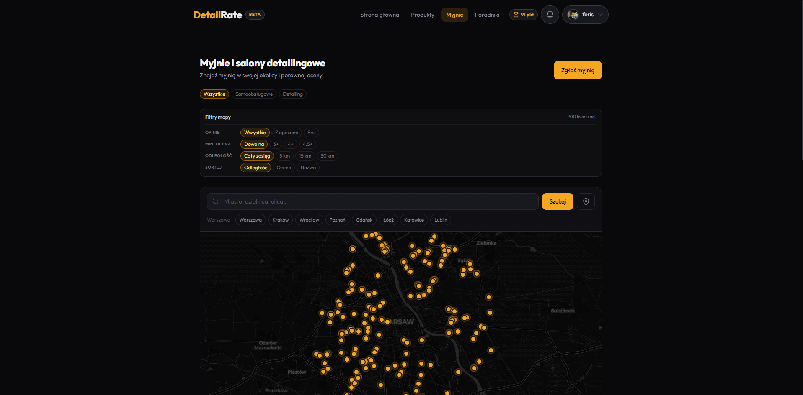
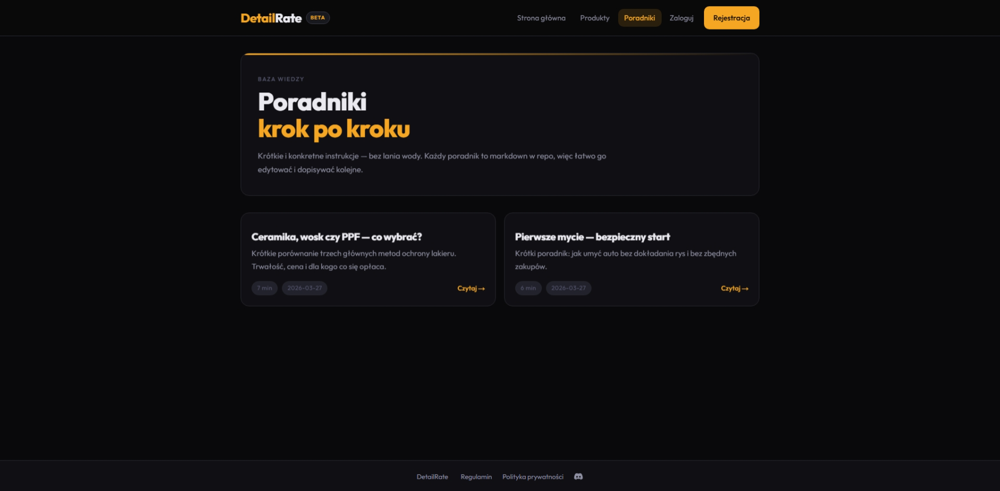

DetailRate to autorski projekt platformy internetowej skupiającej społeczność miłośników pielęgnacji samochodów. Pomysł narodził się z potrzeby stworzenia jednego miejsca do wymiany doświadczeń, sprawdzania opinii o produktach i odkrywania miejsc związanych z detailingiem.

Platforma oferowała między innymi katalog kosmetyków i akcesoriów samochodowych, możliwość oceniania produktów, publikowania recenzji ze zdjęciami, bazę poradników oraz mapę myjni i salonów detailingowych.

Za realizację odpowiadałem samodzielnie. Obejmowała ona projektowanie funkcjonalności, przygotowanie interfejsu, rozwój API, integrację z bazą danych oraz konfigurację środowiska produkcyjnego.

Aplikacja została wcześniej wdrożona i była dostępna dla użytkowników. Obecnie nie działa online ze względu na zakończenie utrzymywania serwera, jednak projekt pozostaje ważnym przykładem mojego doświadczenia w tworzeniu kompleksowych aplikacji full-stack.