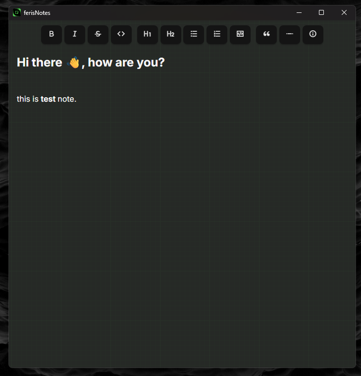

ferisNotes to projekt aplikacji desktopowej, której zadaniem jest uproszczenie codziennego zapisywania i porządkowania informacji. Zależało mi na stworzeniu przejrzystego narzędzia, w którym najważniejszą rolę odgrywa sam edytor.

Aplikacja oferuje interfejs oparty na React.js, a wykorzystanie Tauri pozwala uruchamiać ją jako natywne oprogramowanie desktopowe zamiast tradycyjnej strony internetowej.

Podczas pracy nad projektem skupiłem się na połączeniu wygody znanej z aplikacji webowych z charakterem klasycznego programu instalowanego na komputerze. Była to również okazja do poznania architektury aplikacji opartych na Tauri.