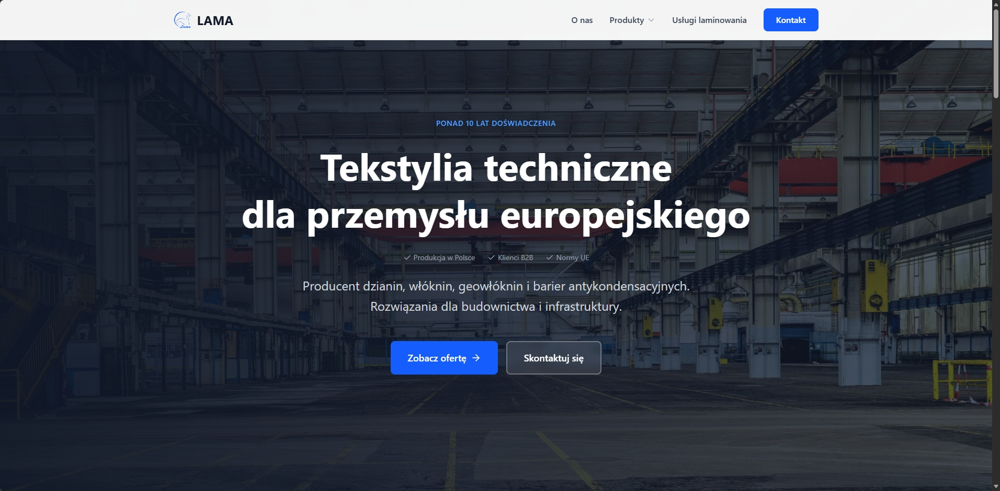
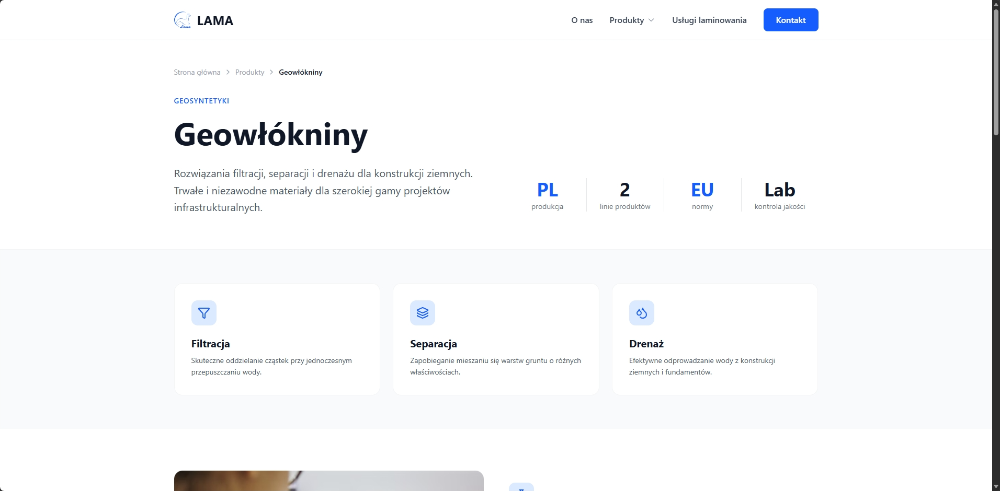

Lama Lama to projekt komercyjny, którego celem było stworzenie strony internetowej prezentującej ofertę polskiej firmy działającej w branży tekstyliów technicznych.

Najważniejszym elementem realizacji było uporządkowanie informacji o produktach i usługach w taki sposób, aby oferta firmy była czytelna i łatwa do przeglądania. Przygotowałem strukturę podstron, komponenty interfejsu oraz warstwę wizualną serwisu.

Do budowy wykorzystałem Astro, natomiast Tailwind CSS posłużył mi do stylowania i dostosowania wyglądu strony do różnych rozmiarów ekranów.

Gotowy projekt został opublikowany za pomocą Netlify i jest dostępny w wersji demonstracyjnej.