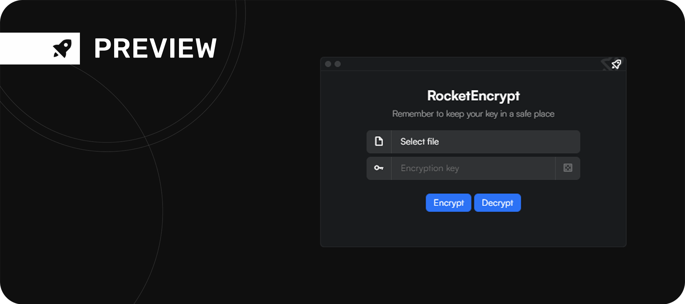

RocketEncrypt to niewielkie narzędzie desktopowe skoncentrowane na jednym konkretnym zadaniu — ochronie plików poprzez szyfrowanie. Aplikacja umożliwia przeprowadzenie procesu szyfrowania, a następnie odzyskanie oryginalnych danych poprzez ich odszyfrowanie.

Projekt został zrealizowany w oparciu o React.js i Tauri. Takie połączenie pozwala wykorzystać technologie frontendowe do budowy interfejsu, jednocześnie zachowując możliwość działania w środowisku desktopowym.

W przeciwieństwie do bardziej rozbudowanych projektów, tutaj skupiłem się na konkretnym zastosowaniu aplikacji i połączeniu prostoty obsługi z funkcjonalnością związaną z bezpieczeństwem danych.